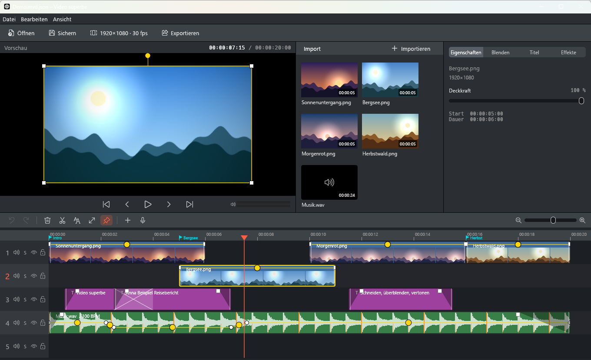
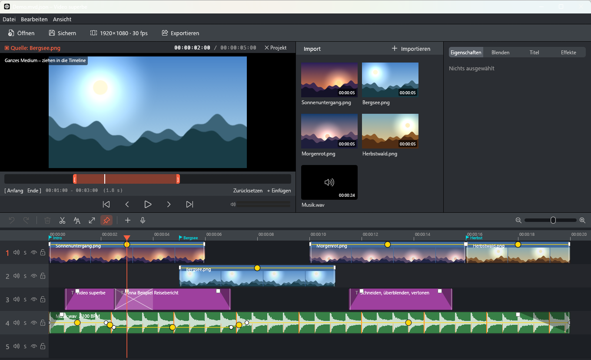
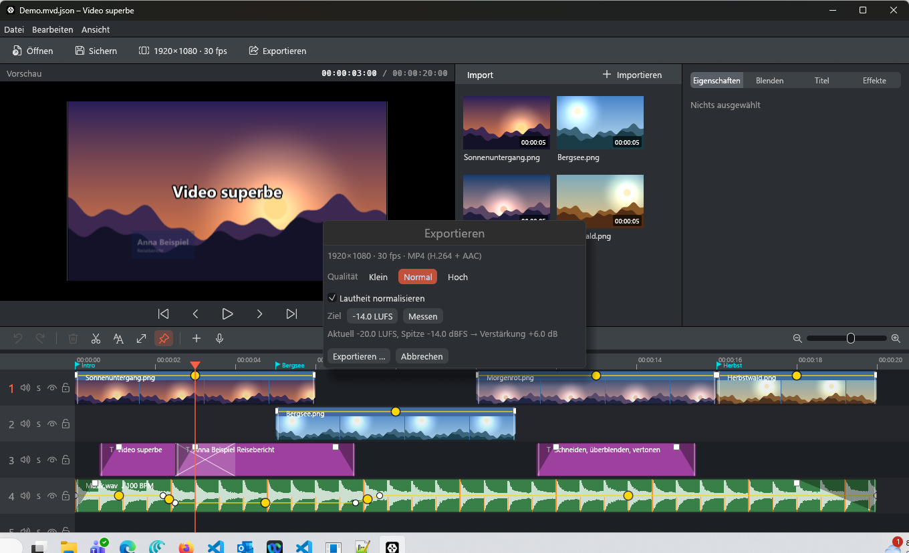
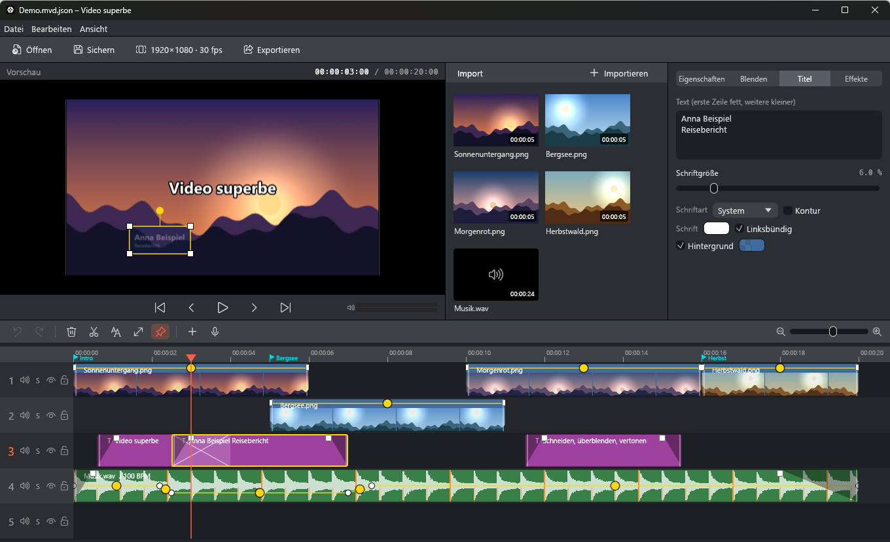
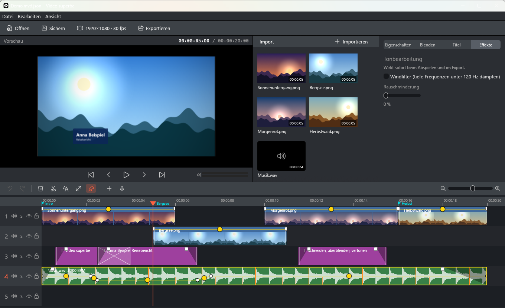
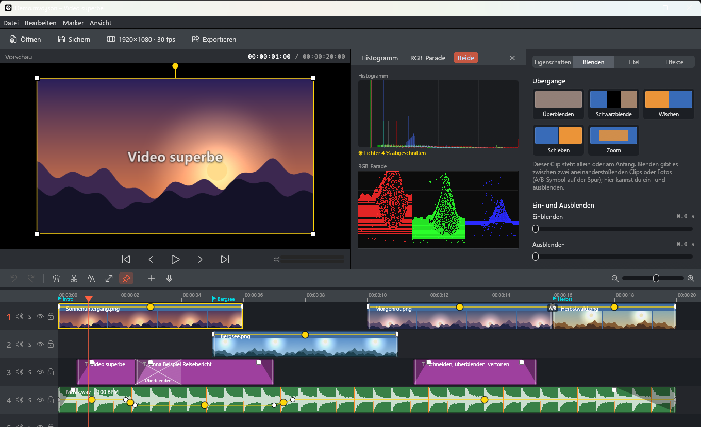
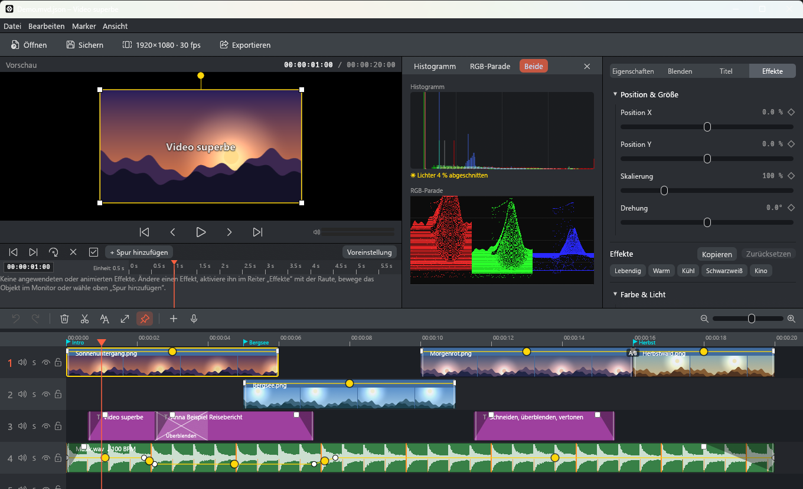

# Video superbe

**Ein schlanker Videoeditor für Windows 11: eine einzelne EXE, keine Installation, keine Abhängigkeiten.**

Schneiden, überblenden, animieren, vertonen und als MP4 exportieren, auch mit iPhone- und GoPro-Material (HEVC/H.265,
HDR). Video superbe ist die Windows-Version des macOS-Programms *MacVideo Deluxe*; Projektdateien (`*.mvd.json`) lassen sich
zwischen beiden austauschen.

> ## ⚠️ Wichtiger Hinweis – bitte lesen
>
> **Video superbe ist ein privates Hobbyprojekt, keine Software für den produktiven Einsatz.**
>
> - **Verwende niemals die einzigen Kopien deiner Videos.** Arbeite immer mit Kopien und behalte die Originale an einem sicheren Ort.
> - Das Programm greift **nicht destruktiv** auf deine Daten zu: Originaldateien werden nur gelesen, nie verändert oder gelöscht. Projekte und Exporte werden in neue Dateien geschrieben.
> - **Es gibt keine Garantie** – weder für Fehlerfreiheit noch für Datensicherheit noch für Eignung für einen bestimmten Zweck. Die Nutzung erfolgt auf eigenes Risiko.



## Download

Die fertige `VideoSuperbe.exe` (64 Bit, rund 8 MB) gibt es unter [Releases](../../releases). Herunterladen, irgendwo
ablegen, doppelklicken. Das Programm braucht nur Windows 11 (bzw. Windows 10 ab 1809) mit den eingebauten Komponenten
(Media Foundation, Direct3D 11) und legt keine Registry-Einträge an. Was es selbst erzeugt (Autosave, Aufnahmen,
Standbilder), liegt im Ordner `VideoSuperbe-Daten` neben der EXE.

## Funktionen

| | |
|---|---|
| **Timeline** | beliebig viele Spuren, Schneiden, Verschieben, Kürzen mit Kantenvorschau, Mehrfachauswahl, Zwischenablage, magnetisches Einrasten (Clips, Marken, Beat-Linien), Gruppen, Projektmarker 1–10, Rückgängig/Wiederholen |
| **Schnittlogik** | Einfügemodi (automatisch, Ripple, Überschreiben), Mausmodi (Auswahl, Ripple-Trim, Rolle), J-/L-Schnitt (Alt-Ziehen), Rollschnitt (Strg-Ziehen), Lückensuche und -schließen, Drei-/Vierpunktschnitt aus dem Quellmonitor, Zeitcode eintippen, Taktschnitt (Schnitte auf Beats) |
| **Medienpool** | Videos, Bilder und Ton per Dialog oder Drag & Drop; Doppelklick hängt ans Ende an; doppelte Dateien werden erkannt; das erste Video legt Format (auch 9:16) und Bildrate fest |
| **Quellmonitor** | Medium ansehen, Anfang/Ende wählen (I/O), Auswahl auf die Timeline ziehen oder einfügen |
| **Blenden** | Überblendung, Abblenden, Blitz, Wischen (seitlich/von oben), Schieben, Zoom, Iris; Kacheln per Drag & Drop auf die Überlappung, Dauer 0,5–2 s |
| **Bild** | Position, Größe, Drehung, Beschnitt, Spiegeln, 90°-Drehung, Horizont-Ausrichtung mit Hilfslinien, Look (Helligkeit, Kontrast, Sättigung, Wärme, Schärfe, Weichzeichner, Vignette), 3D-LUT (`.cube`), Greenscreen (Chroma-Key), **Stabilisierung** (eigene Bewegungsmessung), Effekte kopieren/einfügen |
| **Animator** | Keyframes für alle Kanäle mit Interpolation (linear, Bézier, Halten), Objektrahmen direkt im Monitor |
| **Titel** | Schrift (fett, kursiv, unterstrichen, Laufweite, Zeilenabstand), Schatten, Umrandung, Hintergrund, Bauchbinde, Ein-/Auslaufen (Fliegen, Zoom, Schreibmaschine), Abspann, Laufschrift, Platzhalter (`{datum}`, `{timecode}` …), Vorlagen, Untertitel-Clips, SRT-Export |
| **Ton** | Wellenform, Lautstärkekurve im Clip, Ein-/Ausblenden, Geschwindigkeit, Windfilter, Rauschminderung, Pegelanzeige |
| **Automatik** | Musik bei Sprache abdunkeln (Ducking), Beat-Erkennung, **Ton-Synchronisation** zweier Aufnahmen, **Szenenerkennung** (Clip an Schnitten teilen), Sprecher aufnehmen |
| **Messinstrumente** | Histogramm und RGB-Parade (Ansicht ▸ Messinstrumente) |
| **Ansicht** | Vollbildvorschau (Doppelklick auf den Monitor oder Alt+Enter) |
| **Sonstiges** | Standbild einfügen und exportieren, Kapitelmarken für YouTube, Autosave mit Wiederherstellung, fehlende Medien neu verknüpfen |
| **Export** | MP4 (H.264 + AAC), Qualität mit Größenanzeige, nur der Bereich zwischen den Marken, Lautheit normalisieren (−14 / −16 / −23 LUFS, ITU-R BS.1770) |

Die Vorschau benutzt denselben Renderer wie der Export: Was man sieht, kommt auch in die Datei. Der Renderer rechnet in parallelen Bildbändern auf allen Prozessorkernen und setzt das Vorschaubild nur neu zusammen, wenn sich etwas ändert. Mit `VSB_PERF=1` schreibt das Programm ein Leistungsprotokoll (`perf.log` im Datenordner).

<table>
<tr>
<td><br><sub>Quellmonitor mit Anfangs- und Endpunkt</sub></td>
<td><br><sub>Export mit Lautheits-Normalisierung</sub></td>
</tr>
<tr>
<td><br><sub>Titel: Schrift, Schatten, Umrandung, Bewegung, Vorlagen</sub></td>
<td><br><sub>Lautstärkekurve (Ducking), Beat-Linien, Tonbearbeitung</sub></td>
</tr>
<tr>
<td><br><sub>Blenden-Kacheln und Messinstrumente (Histogramm, RGB-Parade)</sub></td>
<td><br><sub>Effekte, Animator und Messinstrumente</sub></td>
</tr>
</table>

## Wichtige Tasten

Wie in der Mac-Version, mit Strg statt ⌘ und Alt statt ⌥.

| Taste | Wirkung |
|---|---|
| Leertaste, K, L, J | Wiedergabe/Pause, anhalten, abspielen, 1 s zurück |
| S oder T | Teilen an der Abspielposition |
| Z / U | Clip-Anfang / -Ende auf die Abspielposition kürzen |
| 1 / 2 / 3 / 5 | Einfügemodus: automatisch, Einspur-Ripple, Mehrspur-Ripple, Überschreiben |
| 6 / 7 / 8 | Mausmodus: Auswahl, Ripple-Trim, Rolle |
| Umschalt+Ziffer / Strg+Ziffer | Projektmarker 1–10 setzen / dorthin springen |
| `<` / `>`, X, Strg+Umschalt+C | Lücke davor/danach, Lücke markieren, nächste Lücke suchen |
| W / Q | zum nächsten / vorigen Marker (Alt: Schnittpunkt, Umschalt: gewählter Clip) |
| D, F, Alt+F, N | Duplizieren, Zoom auf alles, Zoom auf Bereich, Einrasten |
| Alt+Pfeile | gewählte Clips verschieben |
| G / Umschalt+G | Gruppieren / Gruppe lösen |
| Strg+Alt+C / V | Effekte kopieren / einfügen |
| Umschalt+Z | Szenen erkennen und teilen |
| Strg+Umschalt+M | Schnitte auf Beats legen |
| Alt+Enter | Vollbildvorschau |

Nicht enthalten: Person freistellen, Webcam- und Bildschirmaufnahme, rückwärts abspielen, HEVC-Export und automatische
Untertitel per Spracherkennung.

## HEVC / H.265 (iPhone, GoPro) und HDR

Windows hat für Programme ohne Installation keinen HEVC-Decoder. Video superbe bringt deshalb einen eigenen Weg mit:

- **Grafikkarte**: `src/hevc_gpu.rs` liest Parametersätze und Slice-Köpfe selbst und übergibt die Slices über die allgemeine
  Direct3D-11-Video-API (DXVA) an die Grafikkarte. Das ist herstellerunabhängig (Intel, NVIDIA, AMD); bisher wurde nur Intel
  getestet. Vor der ersten Benutzung vergleicht das Programm je Datei ein Bild der Grafikkarte mit dem des Software-Decoders
  und fällt bei Abweichung automatisch auf diesen zurück. Unterstützt: Main und Main10 (4:2:0, 8/10 Bit).
- **Software-Decoder**: [libde265](https://github.com/strukturag/libde265) (LGPL-3.0), statisch eingebunden, braucht SSE4.1 (jeder
  Intel- und AMD-Prozessor seit etwa 2008), Full-HD etwa 10–20 Bilder pro Sekunde. Erzwingen mit `VSB_HEVC_CPU=1`.
- **HDR (HLG, PQ)**: BT.2020-Material wird beim Decodieren nach SDR/BT.709 umgerechnet (Tonemapping mit weichem Spitzenlicht),
  damit die Farben nicht flach wirken.
- Die Vorschau decodiert im Hintergrund mit Vorlauf; die Oberfläche blockiert nie.

## Selbst bauen

Voraussetzung: Rust (`rustup`, Toolchain siehe `rust-toolchain.toml`) und llvm-mingw
(`winget install MartinStorsjo.LLVM-MinGW.MSVCRT`), nur zum Bauen. Die Linker-Einstellungen stehen in `.cargo\config.toml`
(Ersatz für die in llvm-mingw fehlende libgcc in `shim64\`). `dlltool.exe` muss im PATH liegen (Kopie von `llvm-dlltool.exe`
nach `%USERPROFILE%\.cargo\bin`).

```powershell
cargo build --release     # target\x86_64-pc-windows-gnu\release\video-superbe.exe
```

## Tests

```powershell
powershell -File tests\run-each.ps1      # jeden Test einzeln (ein Absturz reißt nicht alle mit)
powershell -File tests\e2e.ps1 -Exe target\x86_64-pc-windows-gnu\release\video-superbe.exe
```

- `cargo test`: Modell und Schnittregeln, Keyframes, Audio (Decodieren, Mischen, Geschwindigkeit, Filter), Lautheit
  (Referenzwerte der Norm), Analyse (Sprache, Beats, Ducking), Renderer, Export (Zurücklesen, Bereich, Verstärkung, HEVC),
  HEVC (GPU gegen Software, HDR), Quellmonitor, Aufnahme, Autosave, Relink, Standbild, SRT.
- GUI-Tests (`src/gui_tests.rs`): die komplette Oberfläche läuft ohne Fenster; eingespeiste Maus- und Tastaturereignisse prüfen
  die Bedienung.
- `tests/e2e.ps1`: startet die Release-EXE, exportiert headless ein Projekt, liest es zurück, prüft 64 Bit und dass nur
  Windows-eigene DLLs importiert werden.
- Tests mit echten HEVC-Dateien suchen sie im Ordner `Videos\test_vsp` und werden ohne diese Dateien übersprungen.

## Kommandozeile

```
VideoSuperbe.exe [projekt.mvd.json]
VideoSuperbe.exe --export projekt.mvd.json ausgabe.mp4     # Ergebnis in ausgabe.mp4.log
VideoSuperbe.exe --videotest datei.mp4 [sekunden ...]      # schreibt videotest.txt
VideoSuperbe.exe --gpuinfo                                 # Grafikkarte und HEVC-Unterstützung
```

## Lizenzen von Drittkomponenten

- libde265 (`vendor/libde265`): LGPL-3.0, Lizenztext `vendor/libde265/COPYING`, Änderung siehe `vendor/libde265/ABOUT.txt`.
  Der Quellcode liegt diesem Repository bei; die EXE bindet ihn statisch ein.
- Rust-Bibliotheken (eframe/egui, image, rfd, serde, uuid, ab_glyph, windows) unter MIT bzw. Apache-2.0.
